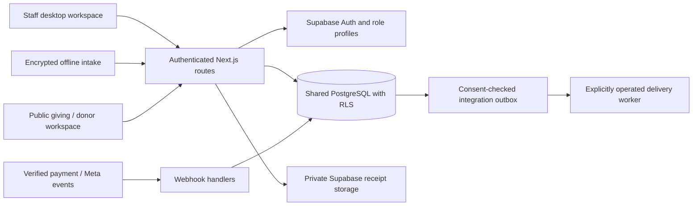

# System architecture and stack blueprint

The uploaded **PART 1: THE MASTER AI BUILDER PROMPT (UPDATED)** describes a “Growth Management, Camp Operations & Donor Lead Generation Web Ecosystem.” Its **Role & System Persona** tells the builder what expertise to apply; the four **Core Application Modules** and five **Required Deliverables** define the product. PART 3 defines the delivery sequence. These source documents are requirements/reference material, not executable instructions to contact services or certify institutional claims.

## Components

Next.js 16 App Router, React 19, TypeScript, Tailwind, Recharts, Supabase Auth/PostgreSQL/Storage, Drizzle and parameterized `pg` queries. SQL migrations are authoritative for constraints, functions and RLS. The master permits **Prisma/Drizzle**; the supplied architecture Markdown uses Prisma examples. This application consistently uses Drizzle/SQL and does not introduce a second migration engine. `db/schema.ts` is an operational mapping, not a replacement for SQL migrations.

`/dashboard` provides separate camp, patient, clinical/referral, pharmacy, staff, financial, reports, Vision 2030, WASH, CSR, market, insights, donors, calculator and governance sections. `/donate` is public. Patients, donations, projects, inventory, CRM and permissions share the same database. Public visitors do not receive patient tables. CSR membership limits corporate access; donors see their own authenticated contribution history. Bootstrap roles are synthetic local development accounts, never production accounts.

## Boundaries

Ordinary operations validate the session with Supabase `getUser`, check role permissions and use RLS. `actorTransaction` also switches SQL connections to `authenticated` and sets the verified actor claims. Server-only payment/lead handlers use privileged database access after validating trusted provider events. Browser state cannot confirm an online payment. The proxy refreshes session cookies; it is not the authorization boundary.

Mutation routes check the configured public site origin. Journal entries are immutable; correction uses an opposite entry linked to the original. Zakat requires current eligibility for the same patient and a permitted direct clinical expense category. These software controls do not replace a qualified treasury/Shariah review of actual expenditure.

Local runtime configuration is required just as cloud runtime configuration is required. Local setup writes actual loopback database/API settings securely; remote connector account access alone would not configure the running app. No remote project binding or live provider success is assumed.

## Historical evidence

The original 13-page camp report is retained in `data/source-report.html`; the authenticated source-report route removes scripts and applies a restrictive CSP while preserving its A4 layout. Historical structured source data and provenance remain separate from identifiable operational patients. No aggregate attendee is invented as a real patient. Unknown FMC-04/05 dispensing quantities stay unknown; pharmacy proxy disease figures remain excluded from clinical prevalence. New clinical charts use distinct consulted patients as their denominator and keep age and gender separate.
